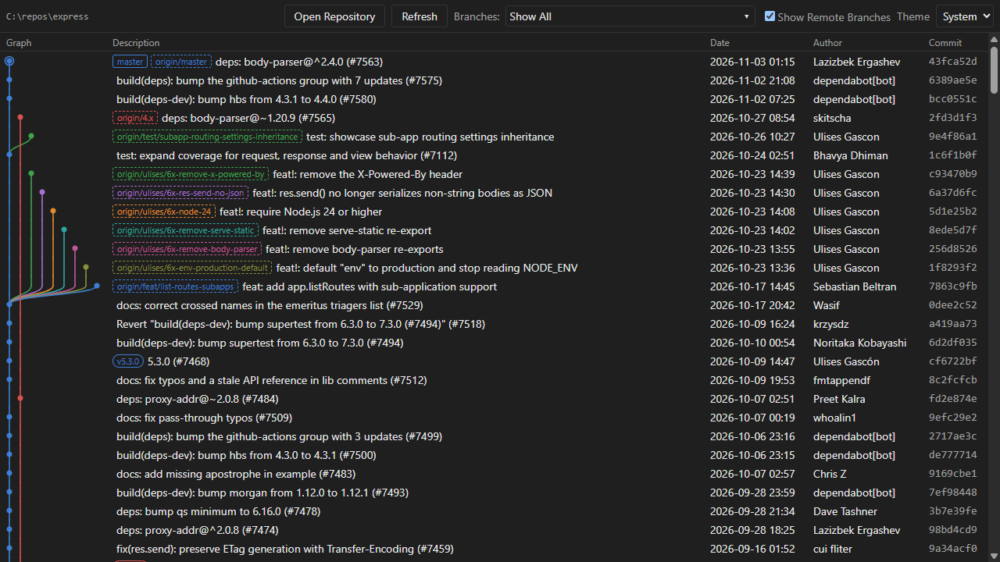

<div align="center">


# Trunks Graph

**The commit graph for Git, as a desktop app.**

Open any repository and travel through its history: every branch and tag on one graph, the branches you choose,
and any commit's details and changed files, without opening an editor.

[](https://github.com/paulo-raoni/trunks-graph/actions/workflows/ci.yml)
[](https://github.com/paulo-raoni/trunks-graph/tags)
[](LICENSE)
[](#install)
[](#safe-by-design)

[Install](#install) · [Features](#features) · [Why](#why-trunks-graph) · [Roadmap](#roadmap) ·
[Contributing](#contributing) · [FAQ](#faq)

</div>

<picture>
  <source media="(prefers-color-scheme: light)" srcset="docs/images/screenshot-light.png">
  
</picture>
<p align="center"><sub>The history of <a href="https://github.com/expressjs/express">expressjs/express</a>, with every remote branch shown.</sub></p>

> **Status: early preview (v0.3.0).** It works today on Windows, reading repositories without ever changing them.
> There is no installer yet: you run it from source with Node. An installer is the next milestone.

## Why Trunks Graph?

Command-line `git log --graph` is hard to read past a handful of branches, and the good graph views live inside
editors. Trunks Graph is a small, focused app that does one thing: shows you how your history actually fits
together.

- **For anyone reviewing history:** see where a branch left, what it carried and where it came back.
- **For teams:** follow the branches you care about and hide the rest.
- **For people who don't use an editor's Git view:** a standalone window you open on any repository.

## Features

<table>
<tr>
<td width="50%" valign="top">

**🌳 One graph for every branch**<br>
Each commit on its own row, with the graph, message, date, author and hash. Branch, remote-branch and tag
labels sit on their commits, and uncommitted changes show as the top row.

</td>
<td width="50%" valign="top">

**🎯 The branches you choose**<br>
A Branches dropdown with Show All, multiple selection and a filter box, plus Show Remote Branches. Both are
remembered for each repository.

</td>
</tr>
<tr>
<td valign="top">

**🔍 Commit details**<br>
Click a commit, a stash or the uncommitted changes to read its details under the row: parents, author and
committer, the whole message, and the changed files as a tree or a list.

</td>
<td valign="top">

**⌨️ Keyboard and layout**<br>
Move between commits with the keyboard. Resize the details area, dock it at the bottom, and it stays that way
after a restart.

</td>
</tr>
<tr>
<td valign="top">

**🌗 Light, dark or system**<br>
A theme switch that applies at once and can follow the operating system.

</td>
<td valign="top">

**📚 Large repositories**<br>
Commits load page by page with Load More. Review round 22 compared the drawn rows with `git log` across the
first 1 200 rows of a 50 000-commit test repository and found no difference.

</td>
</tr>
</table>

### Safe by design

This version **only reads** your repository. It runs read-only git commands and never writes, so you can open
it on any work in progress without risk. Write actions (checkout, merge, rebase and the rest) come in later
milestones, behind menus and confirmation dialogs.

## Install

Until the installer ships, run it from source. You need [git](https://git-scm.com/) and
[Node.js](https://nodejs.org/) 24.18.0.

```bash
git clone https://github.com/paulo-raoni/trunks-graph.git
cd trunks-graph
npm ci
npm start -- /path/to/a/repository
```

Without a path, choose a folder with **Open Repository**. Builds and checks are described in
[`docs/SETUP.md`](docs/SETUP.md).

It is built and verified on Windows. The code is written to be cross-platform, and help verifying it on macOS
and Linux is welcome ([#22](https://github.com/paulo-raoni/trunks-graph/issues/22)).

## Roadmap

The MVP (graph, branch filter, commit details) is done. Next, in order:

- [ ] Windows installer and portable build ([#18](https://github.com/paulo-raoni/trunks-graph/issues/18))
- [ ] Web component and live demo for websites ([#20](https://github.com/paulo-raoni/trunks-graph/issues/20))
- [ ] Graph fidelity: styles, columns, ordering ([#1](https://github.com/paulo-raoni/trunks-graph/issues/1))
- [ ] Context menus and read-only actions ([#2](https://github.com/paulo-raoni/trunks-graph/issues/2))
- [ ] Diff and file viewer ([#3](https://github.com/paulo-raoni/trunks-graph/issues/3))
- [ ] Branch, commit, tag and stash actions ([#6](https://github.com/paulo-raoni/trunks-graph/issues/6),
      [#10](https://github.com/paulo-raoni/trunks-graph/issues/10))
- [ ] macOS and Linux builds ([#19](https://github.com/paulo-raoni/trunks-graph/issues/19))

Every planned milestone is an [issue labelled `roadmap`](https://github.com/paulo-raoni/trunks-graph/issues?q=is%3Aopen+label%3Aroadmap),
and the full plan is in [`docs/PLAN.md`](docs/PLAN.md).

## Contributing

Contributions are welcome. Start with [`.github/CONTRIBUTING.md`](.github/CONTRIBUTING.md), then pick an issue
labelled [`help wanted`](https://github.com/paulo-raoni/trunks-graph/labels/help%20wanted) or
[`good first issue`](https://github.com/paulo-raoni/trunks-graph/labels/good%20first%20issue).

The project runs on a strict workflow contract, [`AGENTS.md`](AGENTS.md): every change is planned as a slice,
built in its own branch, checked by a set of gates (types, unit and mutation tests, end-to-end tests,
performance and size budgets) and reviewed by someone who did not write it.

## FAQ

**Is it related to the Git Graph extension for VS Code?**
It reproduces that extension's behaviour as a standalone app, but it is an independent project. It is **not
affiliated with, endorsed by or sponsored by** Git Graph, its author (mhutchie) or Microsoft. Git Graph's
licence does not allow derivative works to be published, so this is a **clean-room reimplementation**: behaviour
is learned only by using the extension and reading its public Marketplace page, and nothing is taken from its
repository, of any version or fork. The full rule is in [`AGENTS.md`](AGENTS.md) §1.

**Is it related to Git?**
Trunks Graph is a viewer for Git repositories. It is not part of the Git project, which neither makes nor
endorses it. "Git" is a trademark of the Software Freedom Conservancy.

**Why Electron?**
The trade-offs, including the lighter shell that was weighed, are in
[`docs/ADR-0001-stack.md`](docs/ADR-0001-stack.md).
[`docs/ADR-0002-architecture-and-performance.md`](docs/ADR-0002-architecture-and-performance.md) carries the
memory and CPU budgets every change is measured against.

**Can I embed the graph in a website?**
Not yet. A versioned snapshot format and a `<git-graph>` web component are planned:
[`docs/INTEGRATION-WEB.md`](docs/INTEGRATION-WEB.md) and
[#20](https://github.com/paulo-raoni/trunks-graph/issues/20). A hosted mode is an open question
([#21](https://github.com/paulo-raoni/trunks-graph/issues/21)).

## Licence

[MIT](LICENSE) © 2026 Paulo Raoni.
